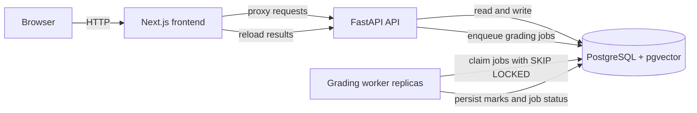
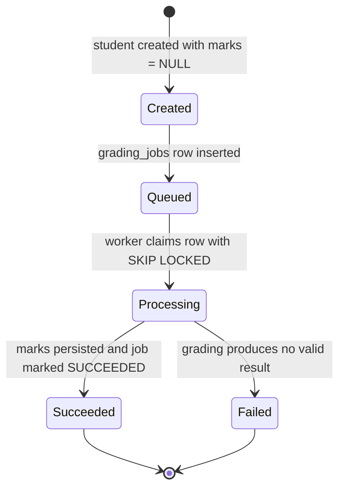
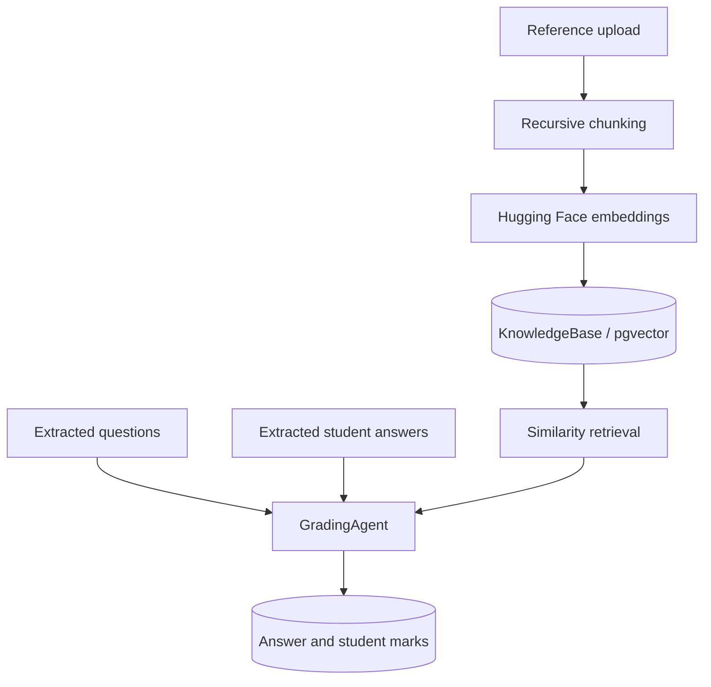

# InkGrader Architecture

InkGrader extracts handwritten exam submissions, grades them with an LLM, and stores results in PostgreSQL. Background grading is handled by a replicated worker pool using a Postgres-backed queue.

## Runtime components

1. **Frontend** — Next.js application on port 3000
2. **API** — FastAPI HTTP service on port 8000
3. **Grading worker** — standalone Python process; multiple replicas may run concurrently
4. **PostgreSQL with pgvector** — application data, vector data, authentication data, and the grading job queue

`backend/core/` (`inkgrader-core`) contains shared business logic. Both the API and worker depend on it as a local `uv` workspace package.

## Request and grading flow

1. The browser calls the frontend's `/api/proxy/*` routes.
2. The proxy forwards requests to the FastAPI service and keeps the backend URL server-side.
3. Answer uploads are extracted and one `grading_jobs` row is created per student.
4. Workers claim queued rows using `SELECT ... FOR UPDATE SKIP LOCKED`. A Postgres advisory lock prevents the same student from being graded concurrently.
5. Workers persist marks and mark jobs as succeeded or failed.
6. The exam page's **Reload Results** button refetches the active graded or ungraded student list. There is no WebSocket connection or automatic polling.

## Backend layout

- `core/`
  - `Agents/` — extraction and grading agents, prompts, tools, and response models
  - `Database/` — SQLAlchemy models, sessions, data-access layers, and advisory locks
  - `FileProcessor/` — OCR, PDF processing, chunking, and embedding helpers
  - `Grading/` — Postgres job queue and per-student grading orchestration
- `api/` — FastAPI application and exam routes
- `worker/` — grading-worker entrypoint

## Frontend detail

- `app/` — route groups for the landing page, dashboard, exams, login, and signup
- `app/api/proxy/exam/...` — server-side routes that forward exam CRUD, uploads, status, and student reads to the backend API
- `app/api/auth/[...all]` — Better Auth handler
- `drizzle/` and `auth-schema.ts` — the authentication schema, separate from the backend's SQLAlchemy grading schema
- `components/` — reusable dashboard and shadcn/ui components
- `app/home/exams/[id]/page.tsx` — exam results view and its explicit result-reload control

## Job lifecycle

Each student gets a durable `grading_jobs` row. The student's result is pending while `Student.marks` is `NULL`.

## RAG grading pipeline

An optional reference file uploaded during exam creation or through the reference endpoint is chunked, embedded, and stored in the `KnowledgeBase` table. `process_rag_material()` uses Chonkie's `RecursiveChunker` and Hugging Face's `sentence-transformers/all-MiniLM-L6-v2` embedding model.

During grading, `rag_tool()` embeds the grading query and performs a pgvector cosine-distance lookup scoped to the exam. `GradingAgent.grade()` combines the retrieved chunks with the question, rubric, and student answer before requesting marks from Groq.

## Scaling and failure behavior

- API replicas remain stateless; durable state lives in PostgreSQL.
- Worker replicas can scale independently. Row-level queue claiming prevents duplicate claims across workers.
- Jobs and marks survive API or worker restarts.
- A failed grading attempt is recorded in the job table. The frontend displays the latest persisted state after a manual reload.
